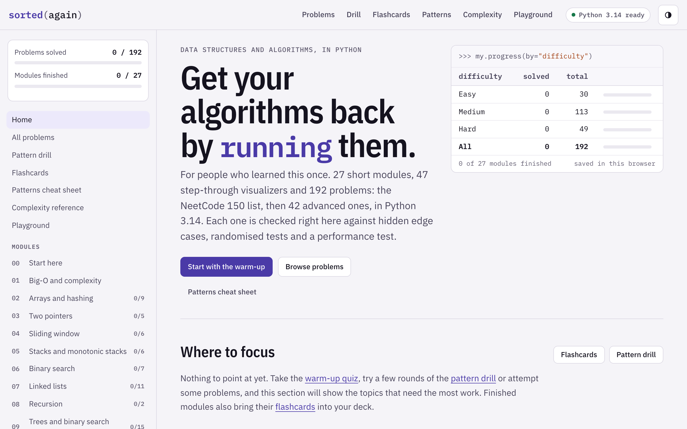

# Sorted Again

**Get your algorithms back by running them.** An interactive data structures and algorithms course in Python, for people who learned this once and want it back, for interviews, for work, or both.

It's one HTML page. Python 3.14 runs inside it (through Pyodide), so there's nothing to install and no server: open the page, read a short lesson, step through a visualizer, then solve problems and check them against hidden tests.

**[Open it now →](https://hossam-04.github.io/sorted-again/)**



## What's inside

- **27 modules.** 19 core modules that cover the NeetCode 150, then an advanced part of 8 for companies that ask Hard problems.
- **192 problems.** The NeetCode 150 (with the Blind 75 marked) plus 42 advanced ones. Each has its own description and tests, starter code, **Run** on the examples and **Check** against hidden edge cases, randomized tests and a performance test. Your code runs in a Web Worker, so an infinite loop times out instead of freezing the page.
- **Hints** that open one at a time, a **reference solution** with its complexity, **alternatives** from brute force to optimal, and **common wrong answers** you can run to see exactly how they fail.
- **47 step-through visualizers**: pointers moving, stacks and heaps changing, trees and graphs being walked, DP tables filling in. You can trace them on your own input.
- **Quizzes** for every module, a **pattern drill**, **flashcards** with spaced repetition, a **patterns cheat sheet**, a **complexity reference** and a **playground**.
- Light and dark themes, readable contrast (WCAG AA), and a phone layout.

| | Core modules | | Advanced part |
|---|---|---|---|
| 00 | Start here (warm-up quiz) | 19 | Ordered data structures |
| 01 | Big-O and complexity | 20 | Greedy with heaps |
| 02 | Arrays and hashing | 21 | Fenwick and segment trees |
| 03 | Two pointers | 22 | Binary lifting and sparse tables |
| 04 | Sliding window | 23 | String matching |
| 05 | Stacks and monotonic stacks | 24 | Advanced graphs |
| 06 | Binary search | 25 | Advanced dynamic programming |
| 07 | Linked lists | 26 | Number theory |
| 08 | Recursion | | |
| 09 | Trees and binary search trees | | |
| 10 | Tries | | |
| 11 | Heaps and priority queues | | |
| 12 | Backtracking | | |
| 13 | Graphs | | |
| 14 | Intervals | | |
| 15 | Greedy algorithms | | |
| 16 | Dynamic programming | | |
| 17 | Bit manipulation and math | | |
| 18 | Interview playbook | | |

## Use it offline

Download [`dsa-course.html`](https://hossam-04.github.io/sorted-again/dsa-course.html) (about 12 MB, because Python is inside it) and open it in any modern browser. The code editor and the fonts load from cdnjs and Google Fonts, so they need an internet connection.

## Your progress

Solved problems, attempts, drafts, finished modules, quiz scores and flashcards are saved **in your browser only**, on this device. Nothing is sent anywhere.

To move your progress, for example from the downloaded file to the online version, or to another device: on the home page, under **Your progress**, press **Copy progress code**, then paste the code into the same box on the other copy and press **Import**. Importing merges: it never removes anything you already have.

## Build it from source

The page is built from `course-src/`. You need Node.js and, for the Python tests, Python 3.

```bash
cd course-src
npm install
npm run build   # verify every example, solution, alternative and wrong answer, then write ../dsa-course.html
npm test        # JavaScript and Python unit tests
npm run e2e     # end-to-end checks in a real browser (Playwright; needs its browsers installed)
```

The build refuses to finish unless every reference solution and alternative agrees on every test, every solution matches a brute-force oracle on random inputs, and every "wrong answer" fails for the reason its explanation gives.

- `course-src/content/modules/` – the lessons, in Markdown
- `course-src/content/problems/<module>/` – one Markdown file per problem: description, tests, hints, solutions and wrong answers
- `course-src/template/` – the page, its styles and scripts
- `course-src/tools/` – the compiler, the verifier and the Pyodide embedder

## License

- The **code** (everything in `course-src/` except `content/`, plus the code examples and solutions inside the lessons) is under the [MIT License](LICENSE).
- The **written course material** (lessons, problem descriptions, hints, explanations, quizzes, flashcards and cheat sheets) is under [CC BY-NC-SA 4.0](LICENSE-CONTENT): share and adapt it for non-commercial use, with credit, under the same license.

Third-party software and fonts are listed in [THIRD-PARTY-NOTICES.md](THIRD-PARTY-NOTICES.md).

## Credits

Made by [hossam-04](https://github.com/hossam-04). Python in the browser by [Pyodide](https://pyodide.org). The problem list follows [NeetCode 150](https://neetcode.io/practice). Every problem links to LeetCode, but all descriptions, examples and tests here are original. Sorted Again isn't affiliated with LeetCode or NeetCode.

Its companion is [SELECT Again](https://github.com/hossam-04/select-again), the same idea for SQL. Both fit into [The Engineer's Syllabus](https://github.com/hossam-04/engineers-syllabus).
